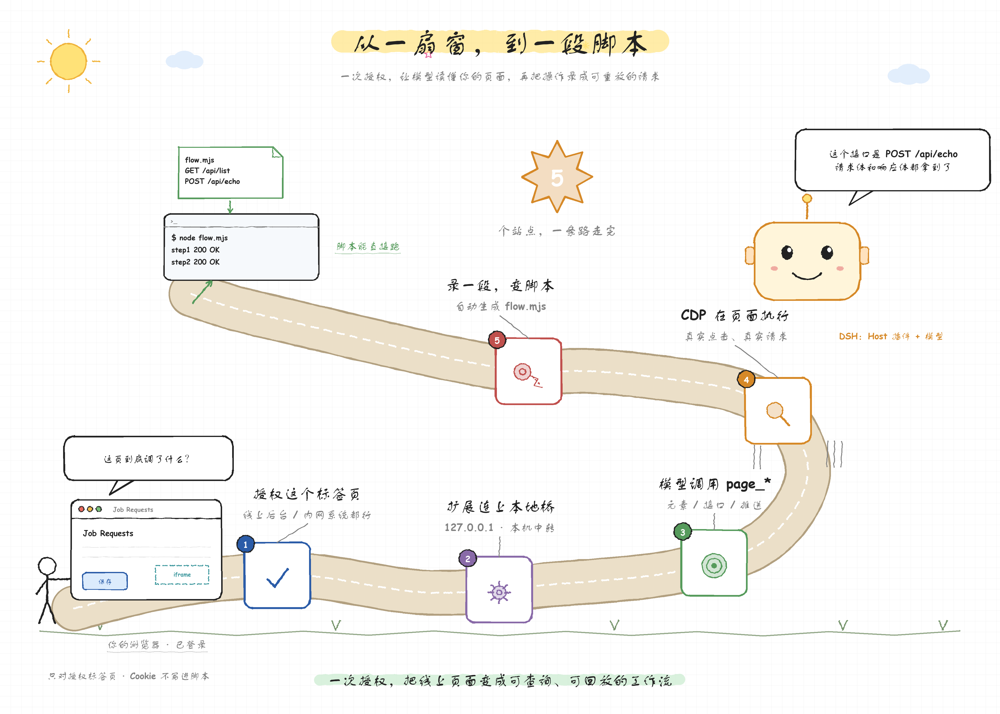
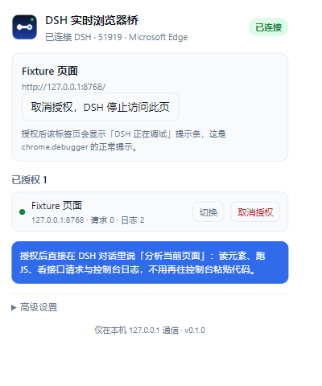

# DSH 实时浏览器桥（dsh_browser）

让你的 **DeepSeek Harness** 直接分析**你自己浏览器里正在看的页面**：读元素、跑 JS、抓接口请求与控制台日志，
不用再把代码贴到 DevTools Console、再把结果贴回对话。



> 手绘图由 `docs/make_journey.py` 生成（`python docs/make_journey.py docs/bridge-journey.png`）；
> 另一版场景插画见 `docs/bridge-poster.png`（`docs/make_poster.py`）。

```
┌───────────────────────┐        WebSocket        ┌──────────────────────────────┐
│ 浏览器扩展 (MV3)       │  127.0.0.1:51919/bridge  │ DSH Host 插件                 │
│ chrome.debugger (CDP) │ ◄──────────────────────► │ dsh-browser-bridge            │
│ 只操作已授权标签页      │      JSON RPC            │ 注册 page_* 工具给模型        │
└──────────┬────────────┘                         └──────────────────────────────┘
           │ CDP
           ▼
┌───────────────────────┐
│ 用户真实浏览器标签页    │  已登录、已开会话、内网/线上系统
└───────────────────────┘
```

## 和已有 `browser_*` 工具的区别

| | `browser_*`（dsh-browser-agent） | `page_*`（本项目） |
| --- | --- | --- |
| 操作对象 | harness 另外启动的 Playwright 浏览器 | **用户自己浏览器**里的标签页 |
| 登录态 | 无（除非自己注入 storage） | 用户当前真实会话（Cookie、SSO、内网） |
| 启动方式 | `browser_open` 首次调用时弹窗 | 用户点扩展「授权当前标签页」 |
| 适用 | 本地开发页面、无登录的网页调试 | 线上后台、内网系统、需要登录才能看的接口 |

两套工具可以并存：本地页面用 `browser_*`，线上/内网页面用 `page_*`。

## 目录

```
dsh_browser/
├─ extension/                 # 浏览器扩展（MV3，Chrome/Edge 116+）
│  ├─ manifest.json          # 固定 key → 固定扩展 ID
│  ├─ sw.js                  # WS 客户端 + chrome.debugger RPC + 网络/控制台捕获
│  ├─ popup.html/css/js      # 状态、授权、端口/令牌设置
│  └─ icons/
├─ dsh-browser-bridge/        # DSH Host 插件（零运行时依赖）
│  ├─ index.js               # 插件入口（启动 WS 服务 + 注册工具）
│  ├─ src/ws-server.js       # 手写 WebSocket 服务端（RFC 6455 子集）
│  ├─ src/bridge.js          # 会话、鉴权、RPC、心跳
│  ├─ src/tools.js           # 11 个 page_* 工具
│  ├─ src/script-gen.js      # 录制结果 → 可重放请求脚本（纯函数）
│  ├─ cordis.patch.yml       # bundle 层：插入插件行
│  ├─ locale/{zh,en}.json    # 插件管理器显示名/描述
│  └─ icon.svg
├─ fixture/                   # 测试页：接口 / CSP / iframe / WebSocket
├─ test/extension.e2e.mjs     # 真实 Edge + 扩展 + 桥的端到端测试
└─ tools/make-icons.mjs       # 重新生成图标
```

## 快速开始

### 1. 加载扩展（每个浏览器一次）

1. 打开 `edge://extensions`（Chrome 用 `chrome://extensions`）。
2. 打开右上角「开发人员模式」。
3. 点「加载解压缩的扩展」，选择本仓库的 `extension/` 目录。
4. 建议把「DSH 实时浏览器桥」固定到工具栏。

扩展 ID 由 `manifest.json` 里的 `key` 固定为 `hlfcjpadcahkpbdnhomoagoekopdmnfo`，
Host 插件默认只接受这个 ID 的连接。



### 2. 安装 Host 插件（本机已装好，换机时执行）

```powershell
# 在 DSH 里让 agent 执行（推荐）：
# plugin_manager install_bundle target="D:\...\dsh_browser\dsh-browser-bridge"
```

插件默认监听 `127.0.0.1:51919`。改端口时（插件 `config.port` 与扩展「高级设置」要一致）：

```yaml
# profile 的 cordis.patch.yml
- id: dsh-browser-bridge
  name: dsh-browser-bridge
  config:
    port: 51919
    token: ''            # 可选配对令牌，两端一致
    extensionIds:
      - hlfcjpadcahkpbdnhomoagoekopdmnfo
```

### 3. 用起来

1. 在浏览器打开要分析的页面（已登录）。
2. 点扩展图标 → 状态显示「已连接」→ 点「授权当前标签页」。
3. 回到 DSH 对话，直接说：
   - 「分析这个页面的表单结构」→ `page_query`
   - 「它调了哪些接口」→ `page_tabs reload` + `page_network`
   - 「点保存，看请求体」→ `page_click` + `page_network wait`
   - 「这里为什么报错」→ `page_console`
   - 「这个弹窗在 iframe 里，看一下」→ `page_frames` + `page_query frame=...`
   - 「看下它的 WebSocket 推送」→ `page_websocket`
   - 「录一段操作，给我一个能重放的请求脚本」→ `page_record start` → … → `page_record stop`

## 工具一览

| 工具 | 作用 |
| --- | --- |
| `page_status` | 连接状态、已授权标签页、默认标签页、最近错误 |
| `page_tabs` | list / focus / navigate / reload（reload 常用于从零抓包） |
| `page_frames` | 列出主页面 + 同源/跨进程 iframe（index、frameId、url、name、深度） |
| `page_eval` | 在已授权标签页（或指定 iframe）执行 JS（`Runtime.evaluate`，绕过页面 CSP，支持 async/await） |
| `page_query` | CSS 选择器读取：text / html / outer / attr / count / box（位置、尺寸、可见性、role/aria），可穿透 Shadow DOM |
| `page_click` | CDP 真实鼠标点击（滚动到可见处，命中 React/Vue 监听；支持 iframe） |
| `page_type` | fill（原生 setter + input/change）/ insert（CDP insertText）/ keys，可 pressEnter；支持 iframe |
| `page_network` | 已捕获请求：方法、URL、状态、耗时、请求头/体、响应头/体；list / wait / clear |
| `page_console` | console.*、未捕获异常、浏览器日志，按级别/文本过滤、增量拉取 |
| `page_websocket` | WebSocket 会话与双向帧（握手、opcode、大小、文本），支持 wait 等推送 |
| `page_record` | 录制点击/输入/回车/导航 + 期间的接口请求，生成 Node 或浏览器可重放脚本 |

`page_eval` / `page_query` / `page_click` / `page_type` 都支持 `frame` 参数（`page_frames` 的 index、frameId、URL 片段或 name）。

## 新能力说明

### iframe（含跨进程）

- `Page.getFrameTree` + `Runtime.executionContextCreated` 维护同进程 iframe 的 contextId；
- 跨进程 iframe（OOPIF）通过 `Target.setAutoAttach` + `Target.sendMessageToTarget` 子会话访问；
- `Page.frameDetached(reason=swap)` 是进程交换而非移除，已单独处理；
- 点击坐标 = iframe 内坐标 + 逐层 `frameElement` / 父帧 `<iframe>` 位置；
- 限制：跨进程 iframe 的**网络请求**目前不进入 `page_network`（它走独立的 Network 域）。

### WebSocket

- `Network.webSocketCreated / HandshakeResponse / FrameSent / FrameReceived / Closed` 全量记录；
- 每个 socket 保留最近 200 帧（单帧文本最多 4000 字符），最多 30 个 socket；
- `page_websocket action=wait` 可以「点一下按钮，等服务端推送」。

### 录制 → 请求脚本

```
page_record action=start
（用户操作，或 page_click / page_type）
page_record action=stop  runtime=node|browser
```

- 页面内注入捕获监听（click / input / change / Enter），经 `Runtime.addBinding` 回传；
- 选择器优先 `data-csi-automation` / `data-testid` / 真实 id / name / aria-label，拒绝 dijit/uniqName 这类自动 id；
- 密码框的值只记 `••••••`；
- 只保留 xhr/fetch 业务请求（过滤 OPTIONS、静态资源、3xx），按时间与操作关联；
- Node 脚本 Cookie 走 `DSH_COOKIE` 环境变量；浏览器脚本用 `credentials: 'include'`，Cookie 不写进脚本；
- multipart 请求体会还原成 `FormData` 代码；含文件的 multipart 保留原始请求体并标注。

## 安全模型

- **显式授权**：只有用户在扩展弹窗里点「授权当前标签页」的标签页才会附加 `chrome.debugger`；
  授权状态存在 `chrome.storage.session`，浏览器重启即失效。模型没有「自我授权」的工具。
- **可见性**：被授权的标签页顶部会显示「DSH 正在调试此浏览器」提示条；打开该标签页的 DevTools 会断开授权。
- **本机通信**：WebSocket 只绑定 `127.0.0.1`；服务端校验 `Origin` 必须是指定扩展 ID，网页来源一律拒绝；
  可选 `token` 做二次校验（`?token=`）。
- **敏感数据**：请求头可能包含 Cookie/Authorization，会进入 DSH 会话与模型上下文；页面内容是不可信数据，
  工具描述里已要求模型只当数据、不当指令。
- **能力边界**：扩展只有 `debugger`、`tabs`、`storage`、`alarms` 与 `<all_urls>` 主机权限，没有读文件、读历史记录等权限。

## 测试

```powershell
cd dsh_browser

# 1) Host 侧协议/鉴权/渲染（不需要浏览器）
node --test dsh-browser-bridge/test/protocol.test.mjs

# 2) 录制脚本生成器（纯函数）
node --test dsh-browser-bridge/test/script-gen.test.mjs

# 3) 真实 Edge + 扩展 + 桥的端到端测试（39 项断言）
node test/extension.e2e.mjs
```

端到端测试会启动一个可见的 Edge 窗口（独立 profile，位于 `_probe/e2e-profile`），
验证元素、JS（含 CSP 严格页）、点击、输入、网络抓包、控制台、iframe（同源/跨进程）、
WebSocket 帧、录制与脚本重放、取消授权等全链路。

## 故障排查

| 现象 | 处理 |
| --- | --- |
| `page_status` 显示未连接 | 确认 DSH 进程在跑；扩展弹窗里看错误；核对端口一致；扩展需在 `edge://extensions` 中启用 |
| 提示「未授权」 | 在目标标签页上点扩展图标 → 授权当前标签页 |
| 提示「调试会话已断开」 | 该标签页打开了 DevTools 或页面崩溃；关闭 DevTools 后重新授权 |
| 抓不到接口 | 授权前页面已加载：先 `page_tabs reload`；或看 `existing`（performance 兜底） |
| 端口被占用 | 改插件 `config.port` + 扩展「高级设置」端口，保存并重连 |
| iframe 里看不到元素 | 先 `page_frames` 找到对应 index；跨进程 iframe 的**网络**请求不进入 `page_network` |
| WebSocket 没有帧 | 授权前连接已建立：先 `page_tabs reload`；二进制帧只显示大小 |
| 录制没有动作 | 录制只覆盖主框架；iframe 内操作请用 `page_eval` 手动触发 |
| 页面在别的浏览器 | 扩展是 Chromium 的：Chrome/Edge 116+；Firefox/Safari 不支持 |

## 已知限制

- `chrome.debugger` 一次只能被一个调试客户端占用：扩展授权期间不能同时开 DevTools。
- 网络缓冲在页面主框架导航时重置（`Page.frameStartedLoading`），所以「从零抓包」要 reload。
- 响应体只读取文本类、≤3MB 的响应，单条最多保留 2 万字符。
- 每标签页网络 1000 条 / 控制台 800 条 / 每 socket 200 帧环形缓冲，进程内存储，扩展重载即清空。
- 跨进程 iframe 的 DOM/JS 可用，但它的子资源网络流量走独立 Network 域，当前未合并进 `page_network`。
- 录制只监听主框架 DOM 事件；iframe 内操作与纯页面内脚本触发的请求不会被记成「动作」，但请求本身仍会被录制。
- 生成脚本不含 Cookie；必须用浏览器会话或 `DSH_COOKIE` 提供，脚本不负责重新登录。
# dsh_browser_bridge

